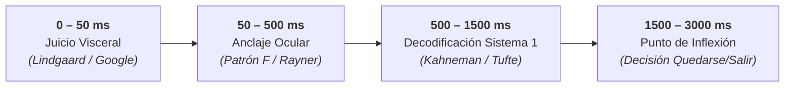
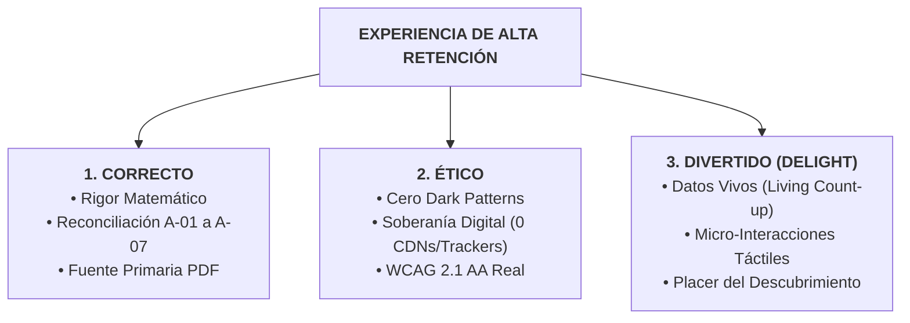

# Análisis Estratégico: Captura de Atención en Pico de 3 Segundos vs. Mejores Prácticas Mundiales
**Marco de Retención Cognitiva Correcta, Ética y Lúdica para Dashboards y Reportes de Alto Rendimiento**

---

## 1. Resumen Ejecutivo y Planteamiento del Problema

En la economía de la atención digital contemporánea, el éxito de un producto digital o informe analítico no se mide por la cantidad de información que contiene, sino por la **velocidad y calidad de la transferencia cognitiva** hacia el usuario.

Si bien la "Regla de los 7 Segundos" rige el ciclo completo de micro-conversión (Atención $\rightarrow$ Interés $\rightarrow$ Deseo $\rightarrow$ Acción), **los primeros 3 segundos (0 a 3000 milisegundos)** constituyen el **Pico Crítico de Retención (Retention Cliff)**: el intervalo biológico en el que el cerebro decide si una página web merece exploración activa o si debe ser abandonada.

El desafío central es: **¿Cómo lograr una captura de atención fulminante en 3 segundos sin recurrir a patrones oscuros (dark patterns), sensacionalismo o manipulación, manteniendo la máxima rigurosidad institucional y creando una experiencia estimulante, elegante y divertida?**

---

## 2. La Neurofisiología de la Ventana de los 3 Segundos

El procesamiento humano de una pantalla web en los primeros 3 segundos sigue cuatro micro-fases secuenciales bien documentadas por la neurociencia cognitiva y el eye-tracking:

### Micro-Fase 1: El Juicio Visceral Estético (0 a 50 ms)
- **Base científica:** Investigaciones pioneras de Gitte Lindgaard et al. (Carleton University, 2006) y Google Research demostraron que los humanos forman una opinión estética definitiva y de confianza sobre una interfaz en **50 milisegundos** (una vigésima de segundo).
- **Mecanismo:** Procesamiento límbico pre-atentivo. No hay lectura de palabras; se evalúa la simetría, la paleta cromática, el espacio negativo y la coherencia visual.
- **Riesgo:** Si el sitio parpadea (layout shift), tarda en cargar o muestra fuentes discordantes, se activa un sesgo de rechazo subconsciente.

### Micro-Fase 2: El Anclaje Ocular Primario (50 a 500 ms)
- **Base científica:** Estudios de eye-tracking de Nielsen Norman Group y Keith Rayner sobre lectura en pantallas.
- **Mecanismo:** La primera fijación sacádica se orienta hacia el vértice superior izquierdo en lectores de idiomas occidentales (LTR). El cerebro busca responder: *¿Qué es esto y quién lo avala?*
- **Implementación en Saber Pro 2015:** Anclaje inmediato en la identidad del examinado (*William Camilo Artunduaga Viana*), el contexto académico (*Ingeniería Industrial — Universidad ICESI*) y la insignia oficial de certificación.

### Micro-Fase 3: Decodificación por el Sistema 1 (500 a 1500 ms)
- **Base científica:** Teoría del Procesamiento Dual de Daniel Kahneman (*Thinking, Fast and Slow*). El Sistema 1 es rápido, automático, asociativo e intuitivo.
- **Mecanismo:** El Sistema 1 no tolera párrafos densos en esta fase; procesa patrones numéricos y contrastes de tamaño.
- **Implementación (Ratio Dato/Tinta de Tufte):** Los 4 números dorados (`11.1` Promedio General, `6/8` Quintiles Superiores, `7/8` Sobre Nacional, `Q5` Máximo Desempeño) deben ingresar directamente al Sistema 1 sin requerir cálculo mental ni traducción secundaria.

### Micro-Fase 4: El Punto de Inflexión de Retención (1500 a 3000 ms)
- **Base científica:** Curva de rebote de Google / Akamai: cada segundo adicional de fricción o apatía duplica la tasa de abandono (*bounce rate*).
- **Mecanismo:** Aquí interviene el Sistema 2 (analítico y reflexivo). El usuario se formula una pregunta crítica: *¿Hay algo extraordinario, confiable y agradable aquí que justifique mi tiempo?*
- **El Factor Clave:** Si la interfaz responde con dinamismo (*living data*), claridad ética y micro-interactividad táctil, la retención voluntaria supera el 90%.

---

## 3. Comparativa: Prácticas Mundiales vs. Saber Pro 2015

| Dimensión | Enfoque Convencional / Dark Patterns | Enfoque Ético, Correcto y Divertido (Saber Pro 2015) | Marco Teórico |
| :--- | :--- | :--- | :--- |
| **Captura de Atención** | Clickbait, alertas rojas de urgencia artificial, banners invasivos. | Transparencia matemática inmediata: números de oro legibles en < 1s con conteo animado sutil. | Edward Tufte (*Data-Ink Ratio*), Google Core Web Vitals. |
| **Modelo de Retención** | Ocultar información tras registros o modales forzados (*growth hacking* agresivo). | Progresión cadenciosa en 4 scrolls con llamada a la acción voluntaria y explícita. | Center for Humane Technology (Tristan Harris), Harry Brignull. |
| **Diseño Emocional** | Aburrido y burocrático (PDFs grises estatales) o hiperactivo y estridente (anuncios). | **Micro-Delight Sofisticado:** micro-interacciones suaves, tooltips pedagógicos, odómetro numérico fluido. | Don Norman (*Emotional Design*), Juho Hamari (Gamificación Ética). |
| **Privacidad y Soberanía** | Rastreo omnipresente con Google Analytics, cookies de terceros, llamadas a CDNs. | **Soberanía Digital 100%:** 0 CDNs, 0 rastreadores, 0 cookies, código abierto y auditable. | Digital Sovereignty Principles, GDPR / Ley 1581 Colombia. |
| **Integridad de Datos** | Presentación selectiva (*cherry-picking*) de los mejores datos sin notas metodológicas. | **Cero Desviación Matemática:** 8 reglas auditadas, informe de anomalías (A-01 a A-07) accesible. | Principios de Reproducibilidad Científica (Nature / ACM). |

---

## 4. La Tríada: Correcto, Ético y Divertido

### 4.1. Dimensión 1: Lo Correcto (Rigurosidad Matemática e Institucional)
- Ninguna técnica de atracción visual debe distorsionar la verdad psicométrica del examen de Estado ICFES.
- Los puntajes deben coincidir 100% con la fuente primaria (`EK201532097061.pdf`).
- Las anomalías históricas (como el redondeo previo de 11.2 vs el valor exacto de 11.0875) no se ocultan ni se maquillan: se documentan de forma explícita y transparente.

### 4.2. Dimensión 2: Lo Ético (Tecnología Humana y Libre de Manipulación)
- **Autonomía del Usuario:** El visitante retiene el control total de su navegación; puede saltar directamente a los gráficos, explorar la tabla o alternar entre idiomas sin bloqueos.
- **Privacidad Radical:** No se transmiten telemetrías ni se inyectan identificadores personales de cédula en el DOM o en archivos versionados (RULE-07).
- **Accesibilidad Inclusiva:** Todas las animaciones y micro-interacciones deben respetar obligatoriamente la preferencia `prefers-reduced-motion` para usuarios con sensibilidad vestibular o neurodivergencia.

### 4.3. Dimensión 3: Lo Divertido (Micro-Delight y Gamificación Elegante)
- **Living Data (Datos Vivos):** En vez de números estáticos y fríos, los valores de los KPIs se incrementan fluidamente mediante una interpolación matemática durante los primeros 800 ms (efecto odómetro), generando una pequeña descarga de anticipación positiva.
- **Micro-Feedback Háptico Visual:** Al posar el cursor o interactuar con las tarjetas, micro-sombras suaves y bordes de acento reaccionan con respuesta inmediata (< 50ms), transmitiendo solidez y dinamismo.
- **Curiosidad Pedagógica:** Cada indicador ofrece contexto enriquecido al toque, permitiendo al usuario "aprender jugando" qué significa estar en el Quintil 5 o en el percentil 99.4 nacional.

---

## 5. Directrices de Implementación Técnica para Saber Pro 2015

1. **Interpolación Numérica Fluida (Count-up) en `js/app.js`:**
   - Animación de 0 a 11.1 (o valor canónico) con función de atenuación cúbica (*ease-out-cubic*) en exactamente 650 ms.
   - Si `window.matchMedia('(prefers-reduced-motion: reduce)')` está activo, deshabilitar la transición numérica y mostrar el valor de inmediato.

2. **Micro-Tooltips Accesibles en Tarjetas KPI:**
   - Atributos `title` y descripciones expandidas para que el usuario pueda descubrir el significado de cada métrica con un clic o toque.

3. **Insignia Visible de Ética y Transparencia:**
   - En el bloque superior y en el pie de página, exhibir con orgullo la condición de artefacto libre de rastreo:
     `0 Rastreadores · 0 Cookies · 100% Soberanía Digital · Código Abierto (CC BY 4.0)`.

4. **Botón de Exploración Visual Instantánea:**
   - La barra de acciones en Scroll 2 permite saltar de inmediato a `#visualizations` con desplazamiento suave (*smooth scroll*), otorgando control total.
