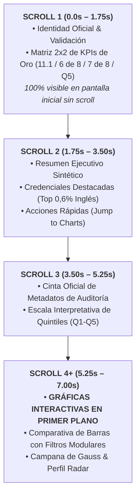

# Heurística de Diseño: "Regla de los 7 Segundos y Arquitectura de los 4 Desplazamientos"
**Marco Metodológico de Optimización Lean, Captación de Atención y Acceso Rápido a Gráficas**

---

## 1. Fundamentos Científicos y Principio de Economía de Atención

En el diseño de dashboards cuantitativos y aplicaciones de reporte, la atención del usuario decae exponencialmente tras los primeros segundos. La **"Regla de los 7 Segundos"** establece que disponemos de un ciclo de micro-conversión temporal de 7 segundos para captar la atención, despertar el interés, inducir el deseo de profundización y detonar la acción.

Para operativizar esta ventana en interfaces táctiles y de escritorio, se formula la **Arquitectura de los 4 Desplazamientos (4-Scroll Architecture)**:
El usuario debe experimentar una progresión cadenciosa donde cada "scroll" o golpe de dedo entrega una dosis exacta de valor, de manera que **a partir del Scroll 4 se desbloquee el acceso directo y protagónico a las visualizaciones gráficas interactivas**.

---

## 2. Especificación Detallada de los 4 Desplazamientos

### Scroll 1: El Anclaje de Autoridad y KPIs de Oro (Pantalla Inicial)
- **Tiempo asignado:** 0.0s – 1.75s.
- **Objetivo:** Responder de inmediato: *¿De quién es esto y cuál es el resultado global?*
- **Componentes:**
  - Cabecera limpia e institucional.
  - Identidad del examinado (*William Camilo Artunduaga Viana*, Ingeniería Industrial, Universidad ICESI) con insignia de certificación verificada.
  - Matriz compacta 2x2 (móvil) o 4x1 (escritorio) de tarjetas KPI:
    1. **11.1** Promedio General Oficial.
    2. **6/8** Quintiles Superiores (Q4/Q5).
    3. **7/8** Sobre Promedio Nacional.
    4. **Q5** Máximo Desempeño.
- **Restricción de diseño:** Debe encajar en el primer viewport ($H \approx 650\text{px} - 850\text{px}$) sin requerir interacción táctil.

### Scroll 2: La Evidencia Narrativa y Mérito Relativo
- **Tiempo asignado:** 1.75s – 3.50s.
- **Objetivo:** Explicar el significado del resultado y proveer vías de acción inmediata.
- **Componentes:**
  - Resumen ejecutivo redactado en un párrafo conciso.
  - Chips de credencial diferenciada (Top 0,6% en Inglés, Percentil 99,4; 87,5% sobre promedio país).
  - Barra de acciones rápidas (`.hero-actions`) con botón directo a `📊 Visualizaciones` y `📋 Tabla de Resultados`.

### Scroll 3: La Validación Oficial y Calibración
- **Tiempo asignado:** 3.50s – 5.25s.
- **Objetivo:** Ofrecer el contexto formal y la regla de calibración antes de examinar los gráficos.
- **Componentes:**
  - Cinta de metadatos oficiales (`.candidate-info-grid`): Código de registro `EK201532097061`, programa, universidad, grupo de referencia y fecha.
  - Escala de quintiles (`#quintileScaleDisplay`): barra visual proporcional que sitúa las 8 materias en su respectivo quintil nacional.

### Scroll 4+: La Inmersión en las Gráficas Interactivas
- **Tiempo asignado:** 5.25s – 7.00s.
- **Objetivo:** **A partir del Scroll 4 el usuario ingresa a la Suite de Visualizaciones (`#visualizations`).**
- **Componentes:**
  - Gráfico de barras comparativo (`#comparisonChart`) con pestañas reactivas (`Todos`, `Genéricas`, `Específicas`).
  - Distribución normal teórica / Campana de Gauss (`#bellCurveChart`).
  - Gráfico radar de competencias (`#radarChart`).
