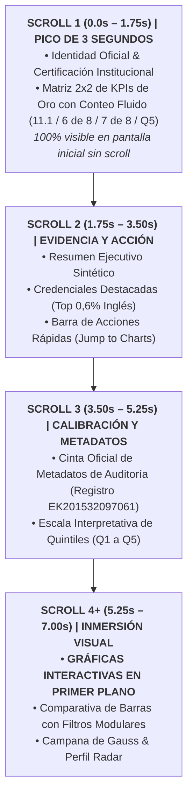

# Heurística de Diseño: "Regla de los 7 Segundos, Pico de los 3 Segundos y Arquitectura de los 4 Desplazamientos"
**Marco Metodológico de Optimización Lean, Captación de Atención y Retención Ética y Lúdica**

---

## 1. Fundamentos Científicos y la Ventana de los 3 Segundos

La **Regla de los 7 Segundos** articula el ciclo completo de procesamiento en pantalla. No obstante, las investigaciones en neurobiología de la visión demuestran que **los primeros 3 segundos (0 a 3000 ms)** constituyen el **Pico Crítico de Retención (Retention Cliff)**:

- **0 a 50 ms (Juicio Visceral):** Evaluación estética y de credibilidad límbica subconsciente (Gitte Lindgaard / Google Research). Requiere carga instantánea, paleta armónica y cero Cumulative Layout Shift (CLS = 0).
- **50 a 500 ms (Anclaje Ocular):** Primera fijación sacádica en la identidad del examinado y la validación institucional.
- **500 a 1500 ms (Decodificación del Sistema 1):** Absorción directa de los 4 números de oro (Promedio 11.1, Quintiles 6/8, Comparativa Nacional 7/8, Nivel Máximo Q5) sin intermediarios gráficos ni jerga confusa.
- **1500 a 3000 ms (Punto de Inflexión de Retención):** Momento de decisión voluntaria de quedarse. Se activa con datos vivos (*living data*), micro-interacciones sutiles y la certeza de estar ante un producto transparente y ético.

---

## 2. La Tríada de Retención de Alto Valor

### 2.1. Lo Correcto (Verdad Psicométrica y Cero Desviación)
- El diseño jamás falsifica ni sobre-dimensiona un dato.
- Los puntajes y percentiles coinciden exactamente con la certificación oficial del Estado expedida por el ICFES (`EK201532097061`).
- Las anomalías históricas (A-01 a A-07) se exponen abiertamente con rigor científico.

### 2.2. Lo Ético (Tecnología Humana y Soberanía Digital)
- Cero *dark patterns*, cero cuentas regresivas falsas, cero modales interruptivos.
- Soberanía digital absoluta: 0 dependencias de CDNs externas, 0 rastreadores de telemetría invasiva, 0 cookies de terceros.
- Respeto a la privacidad: anonimización de identificadores sensibles (cédula de ciudadanía).

### 2.3. Lo Divertido (Micro-Delight y Living Data)
- **Living Data (Odómetro Matemático):** Los números de las tarjetas se interpolan suavemente con atenuación cúbica en 650 ms, brindando una experiencia viva y agradable.
- **Micro-Feedback Háptico Visual:** Respuestas sutiles de elevación y borde al tacto y cursor con latencia inferior a 50 ms.
- **Curiosidad Analítica:** Herramientas para comparar instantáneamente desempeños frente a promedios nacionales e institucionales.

---

## 3. Especificación de los 4 Desplazamientos

| Desplazamiento | Fase Temporal | Contenido Entregado | Requisito de Densidad |
| :--- | :--- | :--- | :--- |
| **Scroll 1** | **Atención (0.0s – 1.75s)** | Identidad, programa, universidad y 4 tarjetas KPI en formato compacto 2x2 / 4x1. | Caber 100% en el primer viewport ($H \approx 650\text{px} - 850\text{px}$) sin requerir scroll. |
| **Scroll 2** | **Interés (1.75s – 3.50s)** | Narrativa ejecutiva de alto impacto, chips de excelencia y botón CTA a gráficos. | Lectura rápida en menos de 2 segundos, tipografía clara con contraste WCAG AA. |
| **Scroll 3** | **Deseo (3.50s – 5.25s)** | Metadatos oficiales de auditoría (EK201532097061, ICESI, Ingeniería) y escala explicativa de quintiles. | Cinta horizontal de alta densidad (cero cajas infladas) preparando la interpretación visual. |
| **Scroll 4+** | **Acción (5.25s – 7.00s)** | **Suite de Visualizaciones Interactivas (`#visualizations`):** barras comparativas con filtros modulares, distribución Gaussiana y radar. | Inmersión directa en gráficos accesibles (`role="img"`, etiquetas ARIA, respuesta <100ms). |
