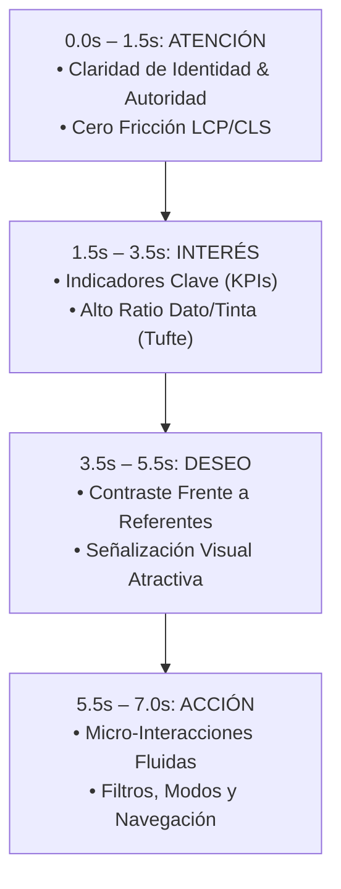

# Heurística de Diseño: "Regla de los 7 Segundos" (The 7-Second Rule)
**Marco Metodológico de Optimización de Interfaces, Captación de Atención y Micro-Interacciones**

---

## 1. Contexto y Fundamentación Científica

En entornos digitales saturados de información, el tiempo cognitivo disponible para cautivar a un observador es extremadamente limitado. Diversos estudios de usabilidad y neuromarketing digital (Nielsen Norman Group, MIT Neurosciences, CXL Institute) demuestran que:
- **50 milisegundos:** Tiempo necesario para formar una primera impresión estética y de confianza visual.
- **2.6 segundos:** Tiempo medio que la mirada tarda en fijarse en el elemento central más relevante de una pantalla.
- **7.0 segundos:** **Pico máximo de atención sostenida inicial.** Es la ventana de decisión crítica en la cual el usuario determina si el sitio merece su tiempo, exploración activa y análisis detallado, o si abandona la navegación por fricción, confusión o fatiga visual.

La **"Regla de los 7 Segundos"** traduce este fenómeno en un protocolo sistemático de diseño de interfaces de usuario para transformar una experiencia pasiva en una experiencia de alto interés, deseo y acción.

---

## 2. El Embudo de Micro-Conversión AIDA en 7 Segundos

### Segundo 0.0 – 1.5: Atención (Attention)
- **Objetivo:** Eliminar la ambigüedad en < 1500 ms.
- **Pregunta del usuario:** *¿Dónde estoy y de quién/qué se trata esto?*
- **Implementación:**
  - Identidad tipográfica limpia.
  - Distintivo de certificación y validez institucional inmediato.
  - Cero dependencias externas que ralenticen el renderizado inicial (Digital Sovereignty, Zero CDN).

### Segundo 1.5 – 3.5: Interés (Interest)
- **Objetivo:** Exponer la propuesta de valor cuantitativa principal.
- **Pregunta del usuario:** *¿Cuál es el dato extraordinario o el hallazgo principal?*
- **Implementación:**
  - Tarjetas KPI prominentes (`.stat-card`) con números grandes en tipografía tabular (`tabular-nums`).
  - Eliminación absoluta de textos repetitivos, nombres duplicados o etiquetas redundantes que obliguen a releer.
  - Síntesis ejecutiva de alto impacto.

### Segundo 3.5 – 5.5: Deseo (Desire)
- **Objetivo:** Crear tensión analítica y curiosidad por profundizar.
- **Pregunta del usuario:** *¿Cómo se compara este resultado frente a los estándares de referencia?*
- **Implementación:**
  - Chips de mérito destacados (e.g. Top 0.6% nacional en inglés, percentil 99.4; 75% en quintiles superiores Q4/Q5).
  - Proximidad visual a las representaciones gráficas interactivas (campana de Gauss teórica, barras comparativas, radar).

### Segundo 5.5 – 7.0: Acción (Action)
- **Objetivo:** Conectar el impulso de exploración con un elemento interactivo intuitivo.
- **Pregunta del usuario:** *¿Qué puedo tocar, cambiar o explorar ahora mismo?*
- **Implementación:**
  - Conmutadores de tema (claro/oscuro) e idioma (ES/EN) visibles en la barra superior.
  - Pestañas de filtrado rápido de visualizaciones (Todos, Genéricas, Específicas) accesibles y reactivas.
  - Atajos de teclado y enlace de salto accesible (`skip-link`).

---

## 3. Protocolo de Auditoría y Verificación de Fricciones

Al evaluar una aplicación contra la Regla de los 7 Segundos, el auditor debe verificar los siguientes 4 factores de fricción:

1. **Fricción por Redundancia (Over-specification):**
   - ¿Se repite el nombre del usuario o candidato más de una vez en la primera vista?
   - ¿Se duplican leyendas institucionales idénticas en cabecera, tarjeta hero y cuadrículas secundarias?
   - *Corrección:* Consolidar en una sola cinta de metadatos de alta densidad (*Single Source of Truth*).

2. **Fricción por Desiertos Espaciales (Vertical Scroll Fatigue):**
   - ¿Existen márgenes o rellenos verticales desproporcionados (> 48px) que empujen los datos sustantivos o los gráficos fuera de la primera pantalla útil?
   - *Corrección:* Reducir `padding-block` de secciones y cabecera; estructurar cuadrículas fluidas con `clamp()`.

3. **Fricción Cognitiva por Desorden Tipográfico:**
   - ¿Hay demasiadas jerarquías visuales compitiendo simultáneamente por la atención?
   - *Corrección:* Aplicar el principio de Tufte (alto ratio dato/tinta); reservar colores de acento para métricas y estados clave.

4. **Fricción de Accesibilidad e Inclusión:**
   - ¿Los elementos interactivos cuentan con `aria-label`, contraste WCAG 2.1 AA (≥ 4.5:1) y enfoque visible (`:focus-visible`)?
   - *Corrección:* Paletas de color auditadas matemáticamente y soporte de reducción de movimiento (`prefers-reduced-motion`).
